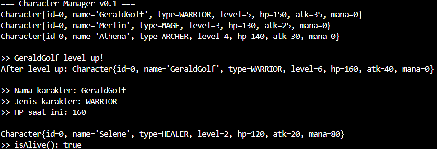
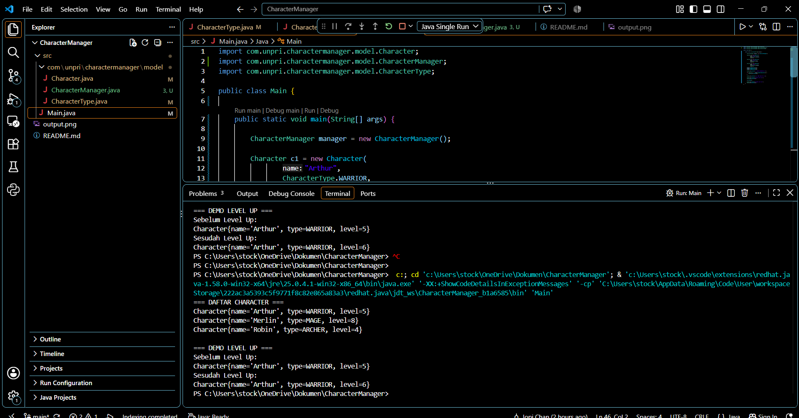

# Character Manager — TP3 (Java Visual SIH-6406)

Proyek ini adalah fondasi model class untuk aplikasi Character Manager, ditulis dengan Java 17. Terdiri dari enum `CharacterType` dan class `Character` yang menerapkan encapsulation, dua constructor, validasi pada setter, serta atribut `mana` dan method `isAlive()`. Class `Main` dipakai untuk mendemonstrasikan pembuatan karakter dan level up.

## Output Terminal



## Struktur Folder

```
CharacterManager/
├── src/
│   ├── Main.java
│   └── com/unpri/charactermanager/model/
│       ├── Character.java
│       └── CharacterType.java
├── output.png
└── README.md
```

## Identitas

- Nama: JOPI CHAN
- NIM: 253303621235
- Analisis Desain (Bagian D):https://1drv.ms/w/c/265fce39944988d2/IQBSaEjTa1-HRouFOAIbQDK6Ab6l14r5AjI12270OtqmmGg?e=eS6DRC

_______________________________________________________________________________________________________________________________

# Character Manager — TP5 (Java Visual SIH-6406)

Deskripsi
Character Manager adalah aplikasi Java sederhana untuk mengelola data karakter game menggunakan konsep Object Oriented Programming (OOP).

Program ini dapat:

Menambahkan karakter
Menampilkan seluruh karakter
Mencari karakter berdasarkan tipe
Menghitung rata-rata level karakter
Melakukan level up karakter
Struktur Project

## Output Terminal ()

## Struktur Folder
src
│
├── Main.java
│
└── com
    └── unpri
        └── charactermanager
            └── model
                ├── Character.java
                ├── CharacterType.java
                └── CharacterManager.java

## Identitas

- Nama: JOPI CHAN
- NIM: 253303621235
- Analisis Desain (https://1drv.ms/w/c/265fce39944988d2/IQBhCxH4lz9DSb6pL-5FAL0sAfvzjrUEsdZ8RusYiMvnTYs?e=4hBBlZ)
